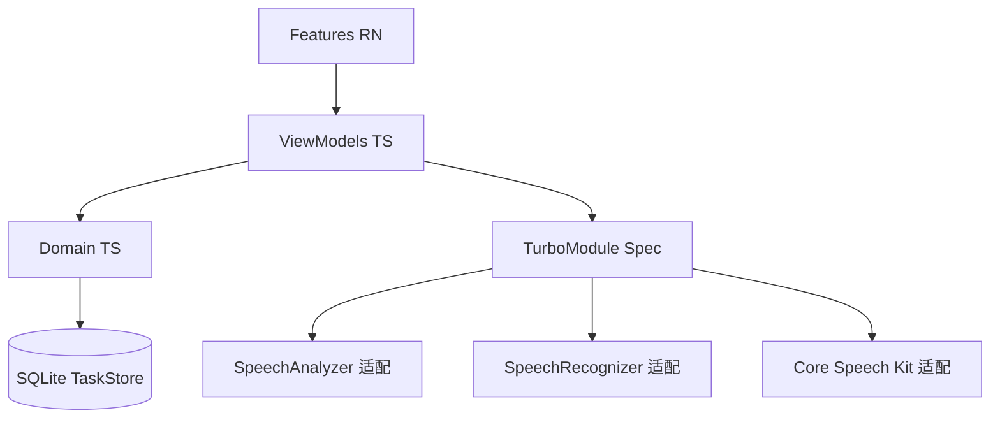

# 02 架构设计 · React Native

目标：JS 负责产品状态与界面；Native 负责媒体与模型。界线画错就会又慢又难测。



---

## 1. 分层

```
src/
  app/                 # 导航、Environment、Registry
  features/            # 只依赖 domain + native 接口
  domain/              # 无 react-native import
  native/              # Spec + JS 包装，无业务规则
  designsystem/
```

| 层 | 可以 | 不可以 |
| --- | --- | --- |
| features | domain、designsystem、native wrappers | `Platform.OS === 'ios'` 写切句 |
| domain | 纯 TS | React、NativeModules |
| native | Spec、权限、分享 | Assembler 规则（规则在 domain，Native 只吐 utterance） |

Assembler / Router / Splitter **放 JS Domain**，三端同一份测试。Native 只发：`{ language, text, isFinal, eventAt }`。

翻译有两种部署：

- **A（推荐 v1）**：Native 翻译，JS 只发 job、收 result（iOS TranslationSession 仍锚在原生 View；Android/鸿蒙在 Service）。  
- **B**：JS 调 ML Kit 不存在。不要用 JS fetch 云翻译。

iOS 约束：`TranslationSession` 必须挂在原生 View。RN 适配器用一个透明 `UIView` + `translationTask`，对 JS 暴露 `translate(job)`。不要试图在 JS 重建 Session。

---

## 2. Native 模块契约

五个 TurboModule，三端实现同一 Spec：

| 模块 | 职责 |
| --- | --- |
| `SpeechEngine` | start/stop、utterance 事件、能力探测 |
| `Translator` | prepare 语言对、translate、cancel |
| `Synthesizer` | enqueue/stop、finished 事件 |
| `AudioSession` | activate use case、route 事件 |
| `DeviceSummary` | availability、summarize |
| `ShareSheet` | 分享文件 URL |

另：`Permissions`（麦克风 / 语音识别）。

事件用 `EventEmitter`（Codegen）。高频 utterance 走 JSI；若某端只能 Bridge，该端面对面标为降级（见折扣文档）。

---

## 3. 模块注册与导航

`FeatureRegistry` 与原生相同。`AppNavigator`：Home → 四模块 → History → Detail。ViewModel 每模块一份，不合并。

同一时刻 JS 保证只 `SpeechEngine.start` 一次。切页 `useEffect` cleanup `stop`。

---

## 4. 任务存储

JS `TaskStore` 接口 + SQLite 实现，便于 iOS/Android 数据形状一致。鸿蒙 RNOH 若 SQLite 不稳，该端可换 Native RDB，但 **SQL schema 与字段对齐**，导入导出才可能。

不要用 AsyncStorage 存全文稿。

---

## 5. 环境对象

```ts
type AppEnvironment = {
  speech: SpeechEngine;
  translator: Translator;
  tts: Synthesizer;
  audio: AudioSession;
  tasks: TaskStore;
  summary: DeviceSummary;
  catalog: LanguageCatalog; // 启动时从 SpeechEngine.capabilities() 填
};
```

测试：全套 fake。Preview / Story 用假流。

---

## 6. 工程边界

```
realtimeTranslatorRN/          # JS
  ios/                         # 薄宿主 + 适配器，可调用 ../realtimeTranslatorOptimize 思路，不 copy-paste 整个 Duiyi
  android/                     # 薄宿主，适配器委托 Android 工程的服务思路
  harmony/                     # RNOH 宿主（v1.1）
```

禁止 RN android 目录变成第二份完整 Android App。适配器应薄：实现 Spec，内部调与原生版同一套 Kotlin/Swift/ArkTS 服务（通过 submodule 或复制 services 层）。产品决策：

- **理想**：原生工程抽 `services` 成可被 RN 宿主链接的 library module。  
- **v1 现实**：先允许复制 services（有测试），RN 只写胶水。抽出 library 放到原生版 M 里程碑之后。

---

## 7. 编码约束

- New Architecture only，`newArchEnabled=true`。  
- Domain 单测用 Jest，不 mock Native。  
- Feature 不直接 `NativeModules.xxx`。  
- 不引入 Redux。模块状态用现有 VM + React state / 极薄 store。  
- 竖屏：各端原生工程锁定，JS 再锁一次防旋转。
