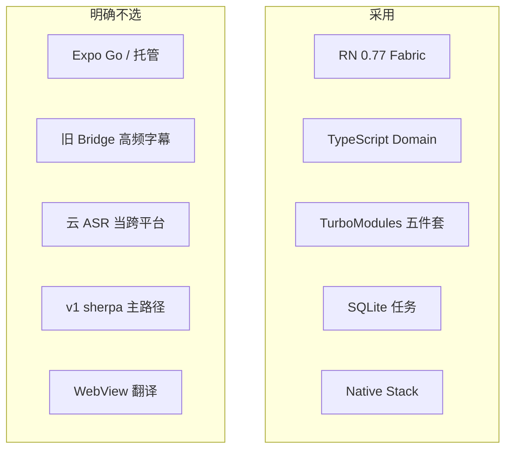

# 03 技术选型 · React Native

---

## 1. 决策总表

| 问题 | 选择 | 不选 | 原因 |
| --- | --- | --- | --- |
| RN 版本 | 0.77 New Architecture | 0.72 旧架构当主；0.82 立刻（鸿蒙未跟上） | Fabric 字幕；RNOH 官方跟 0.77 |
| 语言 | TypeScript 严格 | JS | Domain 要与原生测同一套向量 |
| 导航 | `@react-navigation/native-stack` | JS stack 自己画 | 返回手势、页面生命周期 |
| 动画 | Reanimated 3 | 每帧 `setState` | 倒字与字幕 |
| 听写 | 各端系统端侧 API，经 `SpeechEngine` | JS 录音 + 上传 | 产品承诺 |
| 翻译 | 各端系统 / ML Kit / Translation Kit | 云 API | 同左 |
| TTS | 各端系统 TTS | 云 TTS | 同左 |
| 任务 | SQLite | AsyncStorage | 长稿 |
| 状态 | 模块 ViewModel | Redux / MobX | 体量 |
| 鸿蒙 | RNOH 0.77 **二期** | 假装与 iOS 同日发布 | 库与语音模块都要另写 |
| 跨端模型 | v1 不用 | sherpa-onnx 统一 | 包体、发热、与「系统模型」定位；v2 评估 |

各端 ASR/MT 的具体选择分别服从：

- iOS：`realtimeTranslatorOptimize/docs/03` 与 `07`  
- Android：`../realtimeTranslatorAndroid/docs/03-tech-choices.md`  
- 鸿蒙：`../realtimeTranslatorHarmony/docs/03-tech-choices.md`  

RN 文档不重开一套语音选型。

---

## 2. 为什么还要 RN

省的是：**首页、历史、设置、任务条、文案、导航、导出排版**。不省的是：音频会话、识别、翻译锚点、TTS 路由——这些在三端本就不是同一 API。

预期节省：UI 约 50–70% 工时；媒体链路约 0%，还要多付一层胶水与调试。RN 的正当理由是「三端产品要同步改交互」而不是「一个人三个月打三端」。

若团队只能维护一套原生，优先 Android 或鸿蒙原生工程，不要用 RN 当银弹。

---

## 3. 高频字幕通道

目标：部分结果 10–20 Hz 不上 JS 掉帧。

- Codegen Event + 在 C++ / JSI 侧合并（同一 utteranceId 只保留最新）再进 JS。  
- JS 侧 `useAnimatedReaction` 或只更新 Caption 叶子组件。  
- 禁止：`DeviceEventEmitter` + 每事件 `setCaptions([...])` 复制大数组。

翻译节流仍在 JS 或 Native 任一侧做一次，不要两侧各节流一次导致 final 丢失。

---

## 4. iOS 适配要点

- 最低系统与 Duiyi 相同（iOS 26.4 一类，随主工程）。  
- SpeechAnalyzer / TranslationSession / AVSpeechSynthesizer 包进 TurboModule。  
- Translation 透明宿主 View 必须挂在当前屏幕（面对面两个方向 = 两个原生 host 或一个可换 configuration 的 host）。  
- 不要在 RN 里再写一遍 Swift 6 actor 逻辑，链到现有 Duiyi services。

---

## 5. Android 适配要点

- minSdk 34，on-device recognizer。  
- ML Kit 在 Kotlin 模块，RN 只 prepare/translate。  
- SpeechRecognizer 主线程约束留在 Kotlin。

---

## 6. 鸿蒙适配要点

RNOH TurboModule 用 ArkTS/C++ 实现同一 Spec。Core Speech Kit 的 writeAudio 不能进 JS。v1 可在鸿蒙商店只发原生包。

---

## 7. 权限与分享

- `react-native-permissions` 可接受，或自写薄模块。文案仍走系统弹窗 + 自绘引导。  
- 分享：系统面板。不引入微信。

---

## 8. 测试

| 层 | 工具 |
| --- | --- |
| Domain | Jest + 黄金 JSON |
| VM | Jest + fake native |
| UI | 可选 RNTL，不测听写 |
| 真机 | 与原生同一清单 |

CI 绿 ≠ 可发。发版门禁是真机 P0。
