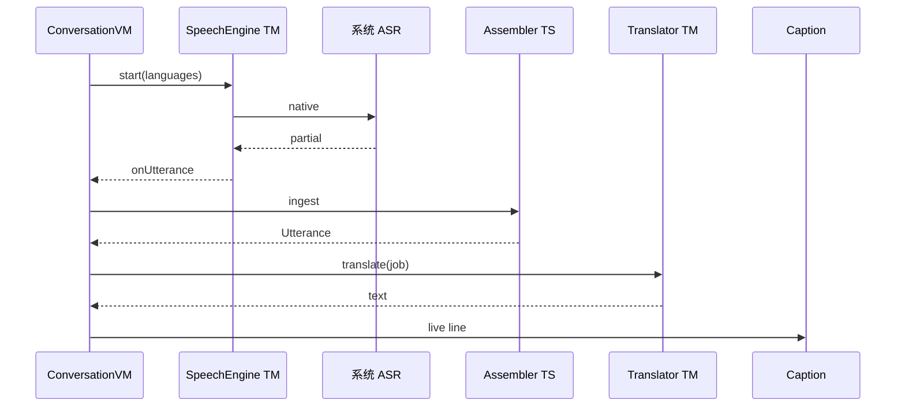

# 04 实现原理 · React Native

JS 状态机 + Native 媒体平面。



---

## 1. 启动

1. JS `bootstrap`：Permissions → `SpeechEngine.capabilities()` → `Translator.installedPairs()` → 填 `LanguageCatalog`  
2. 不合格：Onboarding 失败态（JS）  
3. `TaskStore.hydrate` 未结束任务  
4. Home  

不要在 JS 默认「六语全 true」再等第一次 start 失败。

---

## 2. 听写

`SpeechEngine.start({ languages, fallback, style })`  
`style`: `liveCaptions` | `meetingNotes` — Native 用来设静音窗口，JS 不设毫秒。

事件：

```ts
type SpeechEvent =
  | { type: 'utterance'; id: string; language: AppLanguage; text: string; isFinal: boolean }
  | { type: 'interrupted'; retryable: boolean }
  | { type: 'routeHint'; language: AppLanguage }; // Android 语言检测；iOS 可省略
```

VM `accept` → Assembler（JS）→ Router（JS）→ `translator.translate`。

续听：Native 内部完成，JS 只在 `interrupted && !retryable` 时出「轻点继续」。

---

## 3. 翻译

```ts
translate({ requestId, from, to, text, isFinal }): Promise<string>
cancel(requestId): void
```

VM 保存 `generation`。过期结果丢弃。iOS 适配器把 job 丢进宿主 View 的 session 队列。

prepare：Onboarding 调 `prepare([{from,to}, ...])`，进度事件回 JS 画条。

---

## 4. 同传 TTS

JS `ClauseSplitter` 产出 `Clause`，`Synthesizer.enqueue`。队列上限 2 在 JS 丢弃；Native 一次只说一条。

`AudioSession.activate('interpretationVoiceOut')` 先于第一句 enqueue。`onRoute` 非耳机 → VM 关开关 + `stop`。

---

## 5. 倒字性能

Peer pane 独立组件，props 只有 `live` / `previous` 两个 string。`memo`。旋转用 Reanimated `transform` 一次，不跟文本动画。

禁止用 WebView 渲染字幕。

---

## 6. 任务落盘

与原生同一事件点。`append` 防抖 300 ms，pause/background/end 立即 flush。AppState `background` → `speech.stop` + flush。

---

## 7. 单引擎

`AppEnvironment.speechSession` 互斥锁（JS Promise 链）。Navigation `beforeRemove` stop。Native 再加一层锁防 JS 双 start。

---

## 8. 错误

Native 抛结构化 `{ code: 'notEligible' | 'micDenied' | ... }`。JS Copy 映射六语文案。不要 `e.message` 直接上屏。
