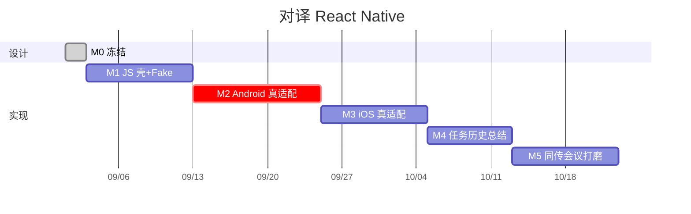

# 07 落地路线图 · React Native

原则：**Domain 与 Fake Native 先绿；再接一端真机（建议 Android，因 iOS 已有 Duiyi 可对照）；iOS 适配器复用 Duiyi services；鸿蒙 RN 最后或不做。**

人员：1 名 RN + 各端原生各能改胶水。约 **10 周**到 iOS+Android 演示（假设 Android 原生 M2 已证明听写可行）。若原生 Android 尚未竖切，RN 不要抢。



鸿蒙 RNOH 不进本图，单开迭代。

---

## 总览

| 里程碑 | 产出 | 过关标准 |
| --- | --- | --- |
| M0 | 文档 + Spec 冻结 | 五模块契约、禁止云 ASR |
| M1 | JS 首页/四模块 UI + Fake 语音 | 点新任务能「假听」出字幕走路由 |
| M2 | Android TurboModule 真听写翻译 | 关网中英打对屏 |
| M3 | iOS TurboModule 接 Analyzer | 与 Duiyi 同一句对比不丢路由规则 |
| M4 | SQLite 任务、历史、导出、总结三态 | 杀进程恢复；13 / 无 Nano 文案对 |
| M5 | 同传 TTS、会议、倒字性能 | 耳机策略；10 分钟会 |

---

## M1 · JS 壳（约 1.5 周）

Navigation、Tokens、FeatureRegistry、Assembler 黄金测试、Fake `SpeechEngine` 按键注入文本。面对面 UI 可点。

验收：Jest 全绿；演示器用按钮模拟双方说话，倒字屏走对。

---

## M2 · Android 真机（约 2 周）

实现 Spec：Speech / Translator / AudioSession。依赖 Android 原生工程已验证的服务层（复制或 module）。

验收：与 Android 原生 M2 同一脚本。关网。无云。

---

## M3 · iOS 真机（约 1.5 周）

Translation 宿主 View、SpeechAnalyzer 适配、与 Duiyi 测试向量对照。

验收：同一段录音（实验室）两侧路由一致。Session 换页不泄漏。

---

## M4 · 平台壳

TaskStore、历史、分享、总结适配器。

---

## M5 · 同传 / 会议 / 性能

ClauseSplitter、TTS、会议合并、Reanimated 倒字、后台 stop。真机清单：一台 iPhone、一台 Pixel。

---

## 依赖

```
Android 原生 M2 ──► RN M2
iOS Duiyi 已有   ──► RN M3
RN M1 ──► M2 / M3（可部分并行）
M2+M3 ──► M4 ──► M5
```

---

## 本阶段不做

- Expo 托管、云 ASR、sherpa 主路径  
- 鸿蒙 RN 发布承诺  
- 双包上架（RN + 原生同名）  
- 热更新修听写  
- 合并 Conversation / Interpretation VM  
